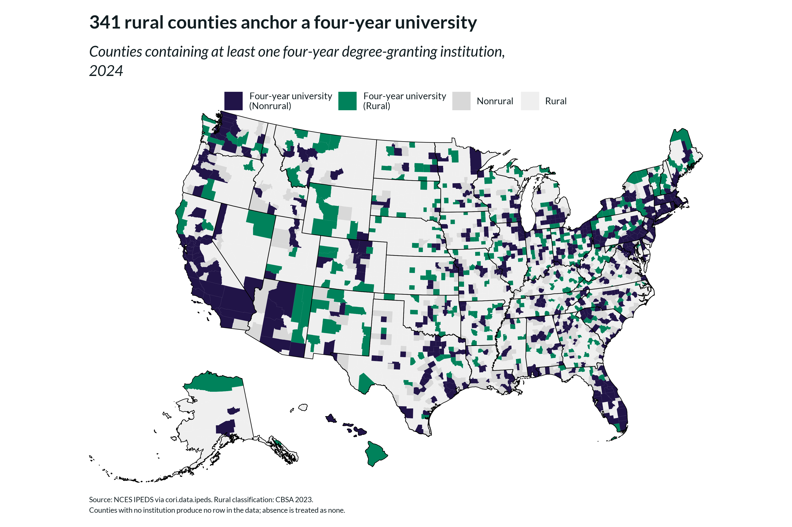
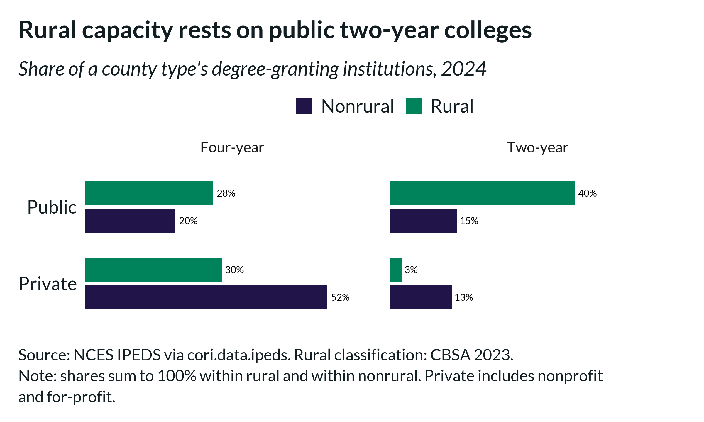
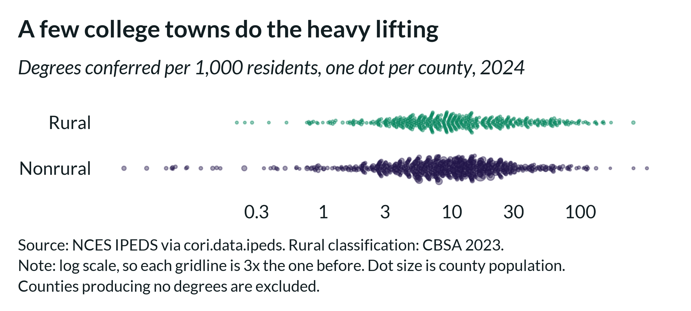
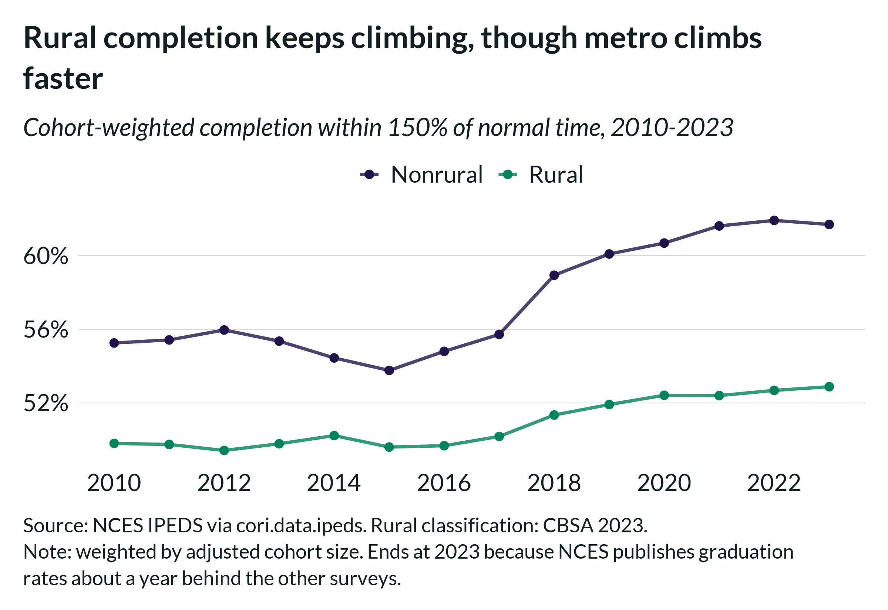
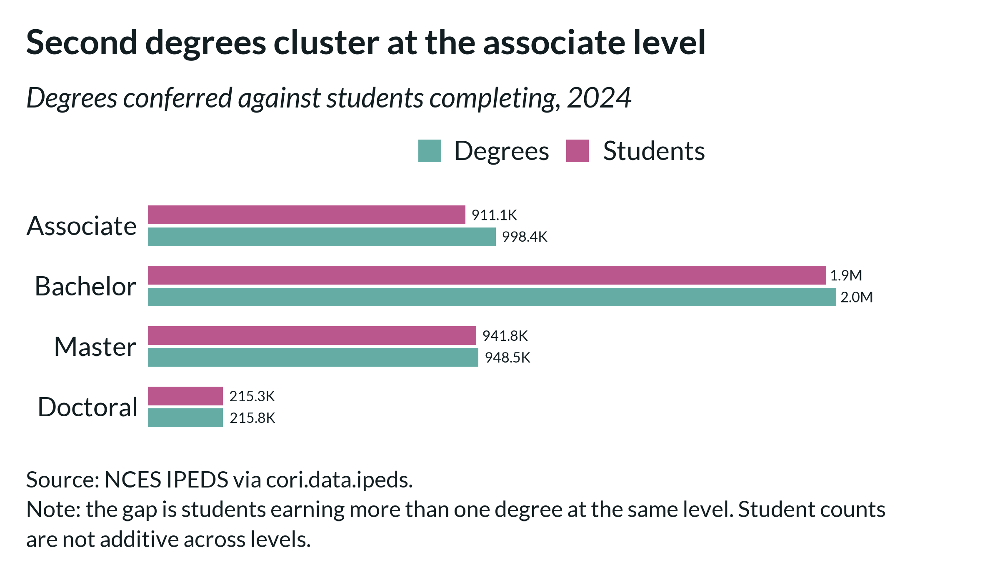
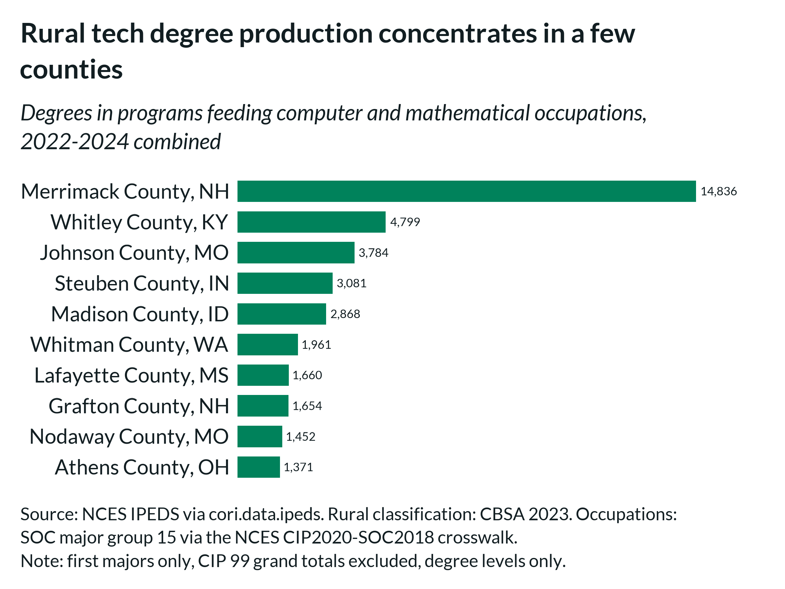

```{r setup, include = FALSE}
knitr::opts_chunk$set(
  collapse   = TRUE,
  comment    = "#>",
  eval       = FALSE,
  fig.width  = 8.888889,
  fig.height = 6.25,
  dpi        = 300
)
```

```{r libraries}
library(cori.data.ipeds)
library(cori.data.pep)
library(ruraldefinitions)
library(cori.charts)
library(dplyr)
library(tidyr)
library(ggplot2)
library(scales)
library(stringr)

load_fonts()
```

Talent is the input every rural economic development strategy depends on, and
higher education is where most of it is produced. But "rural higher education"
is usually discussed as a single thing, when the data describes four separable
questions: **where** institutions are, **what kind** they are, **how much** they
produce, and **whether students finish**.

This vignette works through all four for rural counties, then connects degree
production to occupations via the NCES CIP-to-SOC crosswalk. Every figure here
is reproducible with the code shown, and the last section parameterises it for
a single state.

## The data

Four getters, one per survey, all following the family's
`get_*(geography, geoids, years, variables)` signature:

```{r data}
YR <- 2024

# Institutional presence and composition
institutions <- get_institutions(years = YR)

# Credentials conferred
degrees <- get_degrees(years = YR)

# Students completing (distinct from degrees -- see below)
completers <- get_completers(years = YR)

# Completion outcomes, as a time series
grad_rates <- get_graduation_rates(years = 2010:2023)

# County rural classification -- CBSA-based, 2023 vintage
rural <- cbsa_2023 |>
  select(geoid, is_rural)
```

Everything returns tidy `geoid | year | variable | value | agg_var | survey`,
so the rural split is a single join and the population denominator in the next
section comes from a different package without any reshaping.

## Where rural communities anchor a university

The sharpest version of the capacity question is not how many institutions a
county has but whether it has a **four-year university**, since that is what
anchors a local bachelor's pipeline.

One extraction detail matters first. A county with no degree-granting
institution produces **no row** — absence is how this schema represents
"none" — so the join has to start from the full county list, or it silently
drops exactly the counties the question is about.

```{r access}
has_university <- get_institutions(geography = "institution", years = YR) |>
  filter(is_degree_granting == 1, is_4yr == 1, !is.na(county_fips)) |>
  distinct(geoid = county_fips) |>
  mutate(has_university = TRUE)

access <- rural |>
  left_join(has_university, by = "geoid") |>
  mutate(has_university = coalesce(has_university, FALSE))

access |>
  group_by(is_rural) |>
  summarize(
    counties    = n(),
    with_uni    = sum(has_university),
    without     = sum(!has_university),
    pct_without = 100 * mean(!has_university),
    .groups     = "drop"
  )
#>   is_rural counties with_uni without pct_without
#>   Nonrural     1252      632     620         49.5
#>   Rural        1983      341    1642         82.8
```

**341 rural counties anchor a four-year university**, and they account for 35%
of all counties nationally that do. A further 227 rural counties host a
degree-granting institution without a bachelor's program — most often a public
two-year college, as the next section shows — so 568 rural counties hold
postsecondary capacity of some kind.

That capacity is uneven rather than absent. Mapped, rural universities read as
anchors distributed across the Great Plains, Mountain West and rural South,
each one serving a catchment measured in counties rather than minutes. Where
to site new capacity, and which existing anchors to invest in, is largely a
question about the geography this map describes.

```{r access-chart, echo = FALSE, eval = TRUE, out.width = "100%", fig.alt = "County choropleth map of the United States. Counties containing a four-year degree-granting university are colored, rural ones in green and nonrural in purple, against grey for counties without. Rural counties with a university appear as scattered isolated dots across largely empty interior regions."}

```

## What kind of institutions

Presence alone understates the difference. Switching `geography` to
`"institution"` returns the institution directory rather than county counts —
same function, same arguments, different grain.

```{r institution-type}
ic <- get_institutions(geography = "institution", years = YR) |>
  mutate(geoid = county_fips) |>
  inner_join(rural, by = "geoid") |>
  filter(is_degree_granting == 1)

ic <- ic |>
  mutate(
    level   = if_else(is_4yr == 1, "Four-year", "Two-year"),
    control = if_else(is_public == 1, "Public", "Private")
  )

ic |>
  count(is_rural, level, control) |>
  group_by(is_rural) |>
  mutate(share = 100 * n / sum(n)) |>
  ungroup()
#>   is_rural level     control     n share
#>   Nonrural Four-year Private  1731  52.5
#>   Nonrural Four-year Public    647  19.6
#>   Nonrural Two-year  Private   442  13.4
#>   Nonrural Two-year  Public    480  14.5
#>   Rural    Four-year Private   212  29.6
#>   Rural    Four-year Public    199  27.8
#>   Rural    Two-year  Private    19   2.7
#>   Rural    Two-year  Public    286  39.9
```

Splitting by level and control shows two different sectors. The largest single
category of nonrural institution is the **private four-year** college, at 52.5%.
The largest rural category is the **public two-year** college, at 39.9%. Overall
**rural higher education is twice as public** — 67.7% against 34.2% — so rural
capacity is far more exposed to state appropriations and public enrollment
policy than the metro sector is.

```{r institution-type-chart, echo = FALSE, eval = TRUE, out.width = "100%", fig.alt = "Faceted bar chart of institution shares by level and control. Among rural institutions the largest group is public two-year at 40 percent; among nonrural it is private four-year at 53 percent."}

```

## How much they produce

Counts need a denominator. Population comes from `cori.data.pep` on the same
`geoid`, so the join is one line.

```{r per-capita}
pop <- get_population(geography = "county", years = YR) |>
  filter(variable == "population") |>
  select(geoid, population = value)

per_capita <- rural |>
  inner_join(pop, by = "geoid") |>
  left_join(
    degrees |> filter(variable == "count_degrees_total") |>
      select(geoid, degrees = value),
    by = "geoid"
  ) |>
  mutate(degrees = coalesce(degrees, 0))

per_capita |>
  group_by(is_rural) |>
  summarize(per_1k = 1000 * sum(degrees) / sum(population), .groups = "drop")
#>   is_rural per_1k
#>   Nonrural   12.5
#>   Rural       9.4
```

The aggregate gap is real but it conceals the shape. Plotting one dot per
county shows production spanning more than two orders of magnitude, with a
long rural right tail: **college towns**. Merrimack County NH confers 255
degrees per 1,000 residents, Whitley County KY 171 and Whitman County WA 151 —
each far above any large metro county.

```{r per-capita-chart, echo = FALSE, eval = TRUE, out.width = "100%", fig.alt = "Beeswarm plot of degrees conferred per 1,000 residents, one dot per county, on a log scale. Both rural and nonrural distributions are wide, with a long rural right tail."}

```

This is **production, not attainment**. Degrees are credited to the county of
the institution, not the student's home, so a rural student commuting to a
metro campus appears as metro output.

## How many students finish

Completion rates need weighting. `grad_rate_150pct` is already cohort-weighted
*within* a county; rolling counties up requires weighting by `agg_var`, which
carries the adjusted cohort. An unweighted mean lets a 40-student county
outvote a 40,000-student one.

```{r grad-rates}
trend <- grad_rates |>
  filter(variable == "grad_rate_150pct") |>
  inner_join(rural, by = "geoid") |>
  group_by(year, is_rural) |>
  summarize(rate = sum(value * agg_var) / sum(agg_var), .groups = "drop")

# The same data, weighted and not, for 2023:
#   is_rural  weighted  unweighted
#   Nonrural      61.7        54.5
#   Rural         52.9        47.3
```

**Rural completion is rising.** Rural institutions moved from 49.8% to 52.9%
between 2010 and 2023 — three additional percentage points of a cohort that
finishes. Metro institutions gained faster over the same period, 55.3% to
61.7%, so the gap between them widened from 5.5 to 8.8 points. Both facts
matter: rural capacity is improving, and it is improving from a lower base at
a slower rate.

This series ends at 2023 rather than 2024. NCES publishes graduation rates
about a year behind the other surveys, so the most recent vintage has
completions and institutional characteristics but no completion outcomes yet.

```{r grad-rate-chart, echo = FALSE, eval = TRUE, out.width = "100%", fig.alt = "Line chart of cohort-weighted six-year completion rates from 2010 to 2023. Rural rises from 50 to 53 percent and nonrural from 55 to 62 percent, so both improve while the gap widens."}

```

## People, not just credentials

Two IPEDS files answer two different questions. The Completions file counts
**awards**; the completers file counts **students**. A student earning two
degrees at one level is one completer but two degrees.

```{r completers}
completers |>
  group_by(variable) |>
  summarize(students = sum(value), .groups = "drop")
#>   variable                 students
#>   count_students_assoc       911084
#>   count_students_bach       1946263
#>   count_students_doctoral    215318
#>   count_students_masters     941849
```

Against 4,137,499 degrees conferred, the difference concentrates almost
entirely at the associate level — roughly 10% more degrees than students,
against under 2% at every other level.

```{r completers-chart, echo = FALSE, eval = TRUE, out.width = "100%", fig.alt = "Grouped bar chart comparing degrees conferred with students completing at each award level. The gap is widest at associate level."}

```

Two cautions. These variables are **not additive across levels** — a student
earning a bachelor's and a master's in the same year is counted at both, so
summing them overcounts by roughly 6%. And coverage starts in **2012**; NCES
published no completers file before that, so these four variables are absent
for 2010 and 2011 while everything else is present.

## From degrees to occupations

Degree counts become a workforce measure once programs map to occupations.
`get_cip_soc_crosswalk()` returns the NCES CIP-to-SOC mapping, which makes the
CIP detail on the institution-grain completions table directly usable.

```{r tech}
xw <- get_cip_soc_crosswalk("2020")   # CIP 2020 to SOC 2018

# SOC major group 15 is "Computer and Mathematical Occupations" -- 21 detailed
# occupations, from software developers to data scientists and statisticians.
# Taking the whole group keeps the definition one a reader can check against
# BLS rather than a hand-picked list.
#
# Collapse to a distinct CIP set FIRST. The crosswalk is many-to-many, so
# joining it to completions multiplies rows and inflates any sum afterwards.
cips <- xw |>
  filter(grepl("^15-", soc_code)) |>
  distinct(cip_code) |>
  pull(cip_code)

# Three years combined, to smooth the year-to-year noise in small counties
tech <- get_degrees(geography = "institution", years = 2022:2024) |>
  filter(
    cipcode %in% cips,
    major_num == 1L,              # first majors only
    cipcode != "99.0000",         # drop NCES grand-total rows
    ed_level %in% c(3L, 5L, 7L, 17L, 18L, 19L)
  ) |>
  group_by(geoid = county_fips) |>
  summarize(tech_degrees = sum(count_total_students), .groups = "drop")

rural |>
  left_join(tech, by = "geoid") |>
  mutate(tech_degrees = coalesce(tech_degrees, 0)) |>
  group_by(is_rural) |>
  summarize(degrees = sum(tech_degrees), .groups = "drop")
#>   is_rural degrees
#>   Nonrural  1111620
#>   Rural       89086
```

Across 2022–2024, rural counties produced **7.4%** of degrees feeding computer
and mathematical occupations. 494 rural counties produce any, but the top ten
account for most of the volume — Merrimack County NH alone accounts for 14,836.

```{r tech-chart, echo = FALSE, eval = TRUE, out.width = "100%", fig.alt = "Horizontal bar chart of the ten rural counties producing the most degrees in programs mapping to computer and mathematical occupations over 2022 to 2024, led by Merrimack County NH with 14,836."}

```

Use the **2010** crosswalk vintage for completions years 2010–2019; NCES moved
to the CIP 2020 taxonomy in 2020, and pairing a year with the wrong vintage
mostly appears to work, which is what makes it worth getting right
deliberately.

## Replicating this for your state

Every analysis above is a filter away from being state-specific. The
institution table carries `st_abbr`, which gives the county set for a state:

```{r state}
MY_STATE <- "MT"

state_counties <- get_institutions(geography = "institution", years = YR) |>
  filter(st_abbr == MY_STATE) |>
  distinct(geoid = county_fips) |>
  pull(geoid)

# Any getter then takes those geoids directly
get_degrees(geoids = state_counties, years = YR)
get_graduation_rates(geoids = state_counties, years = 2012:2023)

# Or go the other way: all institutions in one state, with their programs
get_degrees(geography = "institution", years = YR) |>
  semi_join(
    get_institutions(geography = "institution", years = YR) |>
      filter(st_abbr == MY_STATE) |>
      select(unitid),
    by = "unitid"
  )
```

## A note on counting

The institution-grain tables are deliberately unfiltered, because the right
filter depends on the question. Three conventions will inflate a naive sum:

- **`cipcode == "99.0000"`** is each institution's grand total across programs,
  shipped alongside the per-program rows. Including it exactly doubles counts.
- **`major_num == 2`** is the second major of a double-majoring student.
- **Certificates are not degrees.** `ed_level` spans certificates through
  doctorates; county variables count codes 3, 5, 7, 17, 18 and 19 only.

Together the first two inflate a 2024 national degree count from 4.14 million
to 8.46 million. The county getters already apply all three, so this only
matters when aggregating the institution tables yourself. `get_ipeds_codebook()`
documents each one against the variable it affects.

## A note on coverage

`get_ipeds_codebook()` carries a `notes` field per variable recording vintage
caveats; these are the ones that most often change an answer.

**Graduation rates lag.** NCES publishes them about a year behind the other
surveys, so the most recent year typically has completions and institutional
characteristics but no completion outcomes.

**Transfer-out reporting is effectively optional.** A county-year where no
institution reported any transfer-out row is omitted rather than published as
zero, so `transfer_out_rate` is absent for roughly a quarter of the
county-years that do have a graduation rate. A value of 0 means a reported
zero, not missing data.

**Award level codes changed inside the covered period.** Code 1 runs 2010–2019
and is replaced by codes 20 and 21 from 2020. All three are sub-associate
certificates and all three are excluded from degree aggregations, so county
variables are unaffected — but aggregating certificates from the institution
table requires using code 1 before 2020 and codes 20 and 21 after.

**Geography is the institution's, not the student's.** County assignment comes
from the institution's address, so commuting and online enrollment both show up
as production in the campus county.

## Data sources

> The Center on Rural Innovation's curation of U.S. Department of Education,
> National Center for Education Statistics, *Integrated Postsecondary Education
> Data System (IPEDS)*. <https://nces.ed.gov/ipeds/>
>
> The Center on Rural Innovation's curation of U.S. Census Bureau,
> *Population Estimates Program*. <https://www.census.gov/programs-surveys/popest.html>
>
> The Center on Rural Innovation's curation of U.S. Census Bureau,
> *Metropolitan and Micropolitan Statistical Areas (OMB delineations)*.
> <https://www.census.gov/programs-surveys/metro-micro.html>
>
> CIP-to-SOC crosswalk: NCES, *Classification of Instructional Programs*.
> <https://nces.ed.gov/ipeds/cipcode/resources.aspx>
